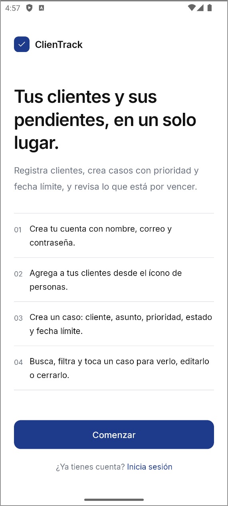
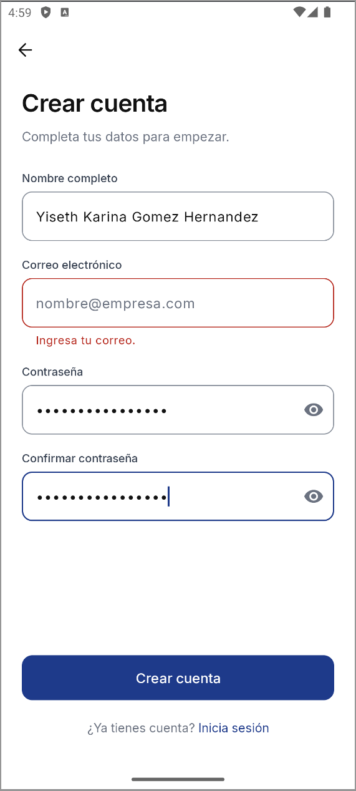
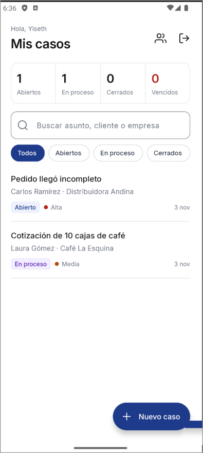
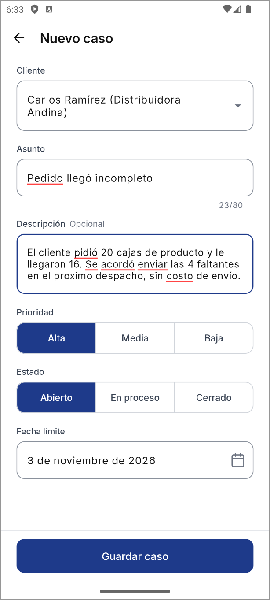
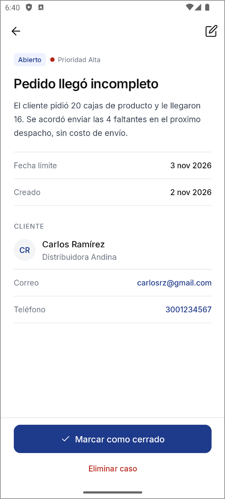
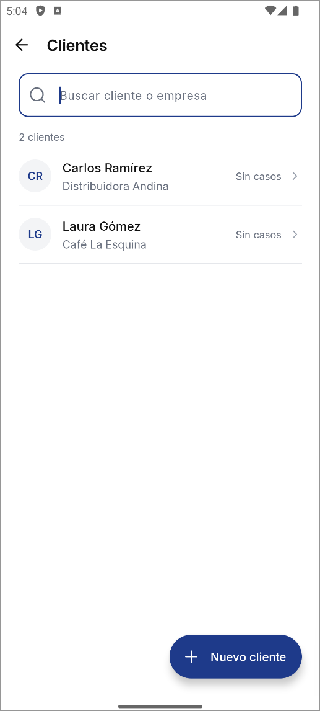
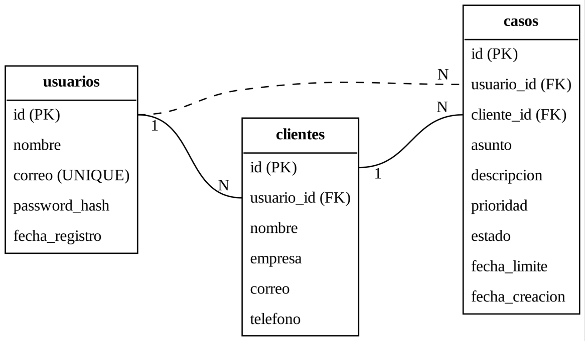

# ClienTrack

ClienTrack es una aplicación Android para llevar el control de clientes y de los casos que surgen con cada uno: solicitudes, quejas o pendientes que hay que resolver antes de una fecha. La idea es tener un CRM sencillo en el celular, pensado para emprendedores o vendedores independientes que hoy manejan todo de memoria o en notas sueltas.

## ¿Qué hace la aplicación?

La app abre con una pantalla de bienvenida que explica cómo usarla. Desde ahí el usuario crea una cuenta o inicia sesión, y la sesión queda guardada.

Adentro puede registrar clientes y crearles casos con asunto, prioridad, estado y fecha límite. La pantalla principal muestra los casos ordenados por prioridad, un resumen por estado con los vencidos, una barra de búsqueda y filtros. Cada caso y cada cliente se puede editar o eliminar, y los casos también se pueden marcar como cerrados.

Los formularios validan los datos antes de guardar, las contraseñas se almacenan cifradas con SHA-256 y cada usuario solo ve su propia información.

## Video de demostración

En este video muestro el funcionamiento de la app y explico el código: https://youtu.be/eJ3cMbVXYho

## Capturas

| Bienvenida | Registro | Mis casos |
|:---:|:---:|:---:|
|  |  |  |

| Nuevo caso | Detalle del caso | Clientes |
|:---:|:---:|:---:|
|  |  |  |

## Tecnologías y versiones

El proyecto está hecho en Java con Android Studio y usa SQLite como base de datos local. Estas son las versiones con las que se desarrolló y probó:

- Android Studio Koala (2024.1.1) o superior
- Java 17 para el código del proyecto
- JDK 21 para ejecutar Gradle
- Gradle 8.7 (se descarga solo con el wrapper)
- Android Gradle Plugin 8.5.2
- compileSdk y targetSdk 34, minSdk 26 (Android 8.0 en adelante)
- androidx.appcompat 1.6.1
- com.google.android.material 1.11.0
- androidx.constraintlayout 2.1.4
- androidx.recyclerview 1.3.2
- Tipografía Inter 4.0 (licencia OFL, incluida en el proyecto)

Todas son versiones estables.

## ¿Cómo ejecutar el proyecto?

1. Clonar el repositorio con `git clone https://github.com/YisethGomez/ClienTrack.git` (o descargarlo como ZIP desde el botón Code > Download ZIP) y abrir la carpeta ClienTrack desde Android Studio con File > Open.
2. Esperar a que termine la sincronización de Gradle. La primera vez descarga las dependencias y puede tardar varios minutos.
3. Si Android Studio muestra el aviso "Please Select Gradle JVM", elegir Use JVM 21. Las versiones recientes de Android Studio traen Java 25 y Gradle 8.7 solo es compatible hasta Java 21. También se puede cambiar en Settings > Build, Execution, Deployment > Build Tools > Gradle > Gradle JDK.
4. Si aparece la sugerencia de actualizar el Android Gradle Plugin, se puede ignorar.
5. Seleccionar un emulador o un celular conectado por USB (con la depuración USB activada) y presionar Run.

Para probarla por primera vez: crear una cuenta, iniciar sesión, agregar un cliente desde el ícono de personas de la barra superior y luego crear un caso con el botón +.

## Arquitectura

Usé el patrón MVC (Modelo, Vista, Controlador), que es el que vimos en clase y el que mejor se acomoda a un proyecto con Activities y SQLite:

- Modelo: las clases Usuario, Cliente y Caso, y la clase DatabaseHelper, que es la única que habla con la base de datos.
- Vista: los archivos XML de res/layout, que solo definen cómo se ve cada pantalla.
- Controlador: las Activities. Reciben lo que hace el usuario, validan los datos, le piden al modelo que guarde o consulte y actualizan la pantalla.

Así ninguna pantalla escribe SQL directamente y si cambia la base de datos solo hay que tocar DatabaseHelper.

## Organización del código

El código está dividido por responsabilidades dentro de `app/src/main/java/co/edu/ean/clientrack`:

- ui: las pantallas de la aplicación.
- adapter: los adaptadores que muestran las listas de casos y clientes.
- model: las clases Usuario, Cliente y Caso.
- data: la clase DatabaseHelper, donde se crean las tablas y están todas las consultas a SQLite.
- util: manejo de la sesión, validaciones y utilidades para fechas y colores.

El diseño de las pantallas está en res/layout, los colores, estilos y textos en res/values y la tipografía en res/font.

## Base de datos

La base de datos se llama clientrack.db y se crea en el dispositivo la primera vez que se abre la app. Tiene tres tablas: usuarios, clientes y casos. Un usuario tiene muchos clientes y cada cliente puede tener muchos casos.

El detalle de las tablas, sus relaciones y la lógica de la aplicación está en el archivo DOCUMENTACION_TECNICA.pdf. Un resumen de dos páginas con la arquitectura, el esquema de datos y las validaciones está en DOCUMENTO_TECNICO_BREVE.pdf.

## Pruebas

El proyecto incluye pruebas unitarias en `app/src/test` (validaciones, formatos de fecha y la regla de casos vencidos) y pruebas de interfaz en `app/src/androidTest` (registro, inicio de sesión y el flujo de crear, cerrar y eliminar un caso). Se pueden ejecutar desde Android Studio con clic derecho sobre la carpeta y Run Tests. Las de interfaz necesitan un emulador abierto o un celular conectado.

## Autor(a)

Yiseth Karina Gomez Hernandez  
Universidad EAN, 2026
